# ⚽ FootyCore — Premier League Management System

İngiltere Premier League için geliştirilmiş web tabanlı bir lig yönetim sistemi. Maçların, fikstürün, skorların, maç olaylarının ve istatistiklerin yönetilmesini sağlar.

ASP.NET Core Web API, ASP.NET Core MVC ve Entity Framework Core teknolojileriyle geliştirilen proje, **N katmanlı mimari** yaklaşımını benimser. Web arayüzü verilere API üzerinden erişir ve lig puan durumu tamamlanan maçların sonuçlarından dinamik olarak hesaplanır.

## 🚀 Teknolojiler

- **Backend:** C#, .NET 8, ASP.NET Core Web API
- **Frontend:** ASP.NET Core MVC, Razor Views
- **ORM:** Entity Framework Core
- **Veritabanı:** Microsoft SQL Server
- **Mimari:** N-Tier Architecture, Repository Pattern
- **Veri Dönüşümü:** DTO, AutoMapper
- **API Dokümantasyonu:** Swagger / OpenAPI

## 🏗️ Proje Mimarisi

Proje, sorumlulukların ayrı katmanlarda yönetildiği N katmanlı mimariyle geliştirilmiştir.

| Katman | Sorumluluk |
|---|---|
| `EntityLayer` | Takım, maç, lig, sezon, stadyum ve maç olayları gibi varlıklar |
| `DataAccessLayer` | Entity Framework Core, repository yapısı ve veritabanı işlemleri |
| `BusinessLayer` | İş kuralları, servisler, AutoMapper ve puan hesaplama |
| `DtoLayer` | API istek ve yanıtlarında kullanılan veri modelleri |
| `Api` | RESTful HTTP endpoint'leri |
| `WebUI` | Kullanıcı arayüzü ve admin paneli |

## ✨ Özellikler

### 🏟️ Fikstür ve Maç Yönetimi

- Haftalık maç fikstürü oluşturma ve düzenleme
- Ev sahibi ve deplasman takımlarını belirleme
- Maç tarihi, saati, stadyumu ve durumunu yönetme
- Sezon ve hafta bazlı fikstür filtreleme
- Maçları durumlarına göre listeleme

### ⚽ Skor ve İstatistik Yönetimi

- Maç skorlarını girme ve güncelleme
- İlk yarı ve ikinci yarı gol bilgilerini tutma
- Şut, isabetli şut ve topa sahip olma istatistiklerini yönetme
- Maç detaylarını görüntüleme

### 🟨 Maç Olayları

Maçlara bağlı olaylar dakika, tür ve açıklama bilgileriyle yönetilir.

- ⚽ Gol
- 🟨 Sarı kart
- 🟥 Kırmızı kart
- 🔄 Oyuncu değişikliği

Oyuncu değişiklikleri, giren ve çıkan oyuncu bilgileriyle kaydedilir.

### 🏆 Dinamik Puan Durumu

Puan durumu ayrı bir veritabanı tablosunda tutulmaz; tamamlanmış ve skoru bulunan maçlar üzerinden hesaplanır.

| Maç sonucu | Puan |
|---|---:|
| Galibiyet | 3 |
| Beraberlik | 1 |
| Mağlubiyet | 0 |

Puan durumu hesaplamasında kullanılan bilgiler:

- Oynanan maç sayısı
- Galibiyet, beraberlik ve mağlubiyet sayıları
- Atılan ve yenilen goller
- Gol averajı
- Toplam puan
- Son beş maçın form durumu (`W`, `D`, `L`)

## 🖥️ Uygulama Sayfaları

### Kullanıcı Arayüzü

| Sayfa | Açıklama |
|---|---|
| Anasayfa | Aktif sezonun maçlarını ve haftalık karşılaşmaları görüntüleme |
| Fikstür | Sezon ve hafta bazında maç programını inceleme |
| Maç Detayı | Gol, kart, değişiklik ve istatistikleri görüntüleme |
| Puan Durumu | Tamamlanan maçlardan hesaplanan lig sıralamasını inceleme |

### 🔐 Admin Paneli

| Rota | İşlev |
|---|---|
| `/Admin/Fixture` | Yeni maç oluşturma ve fikstür yönetimi |
| `/Admin/Match` | Skor ve maç istatistiklerini yönetme |
| `/Admin/MatchDetail` | Gol, kart ve oyuncu değişikliği olaylarını yönetme |

🖼️ Ekran Görüntüleri
  
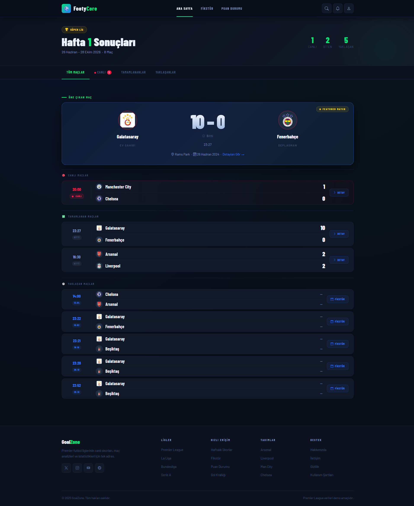
  
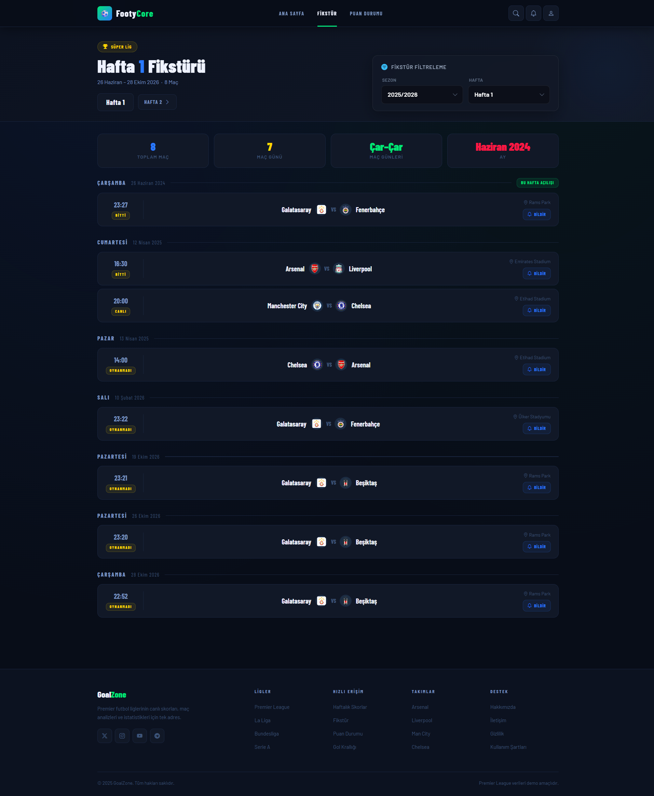
  
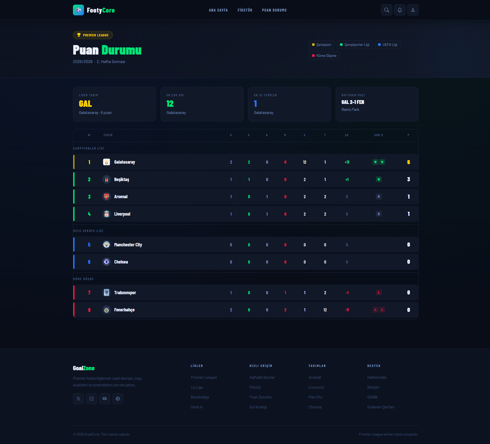
  
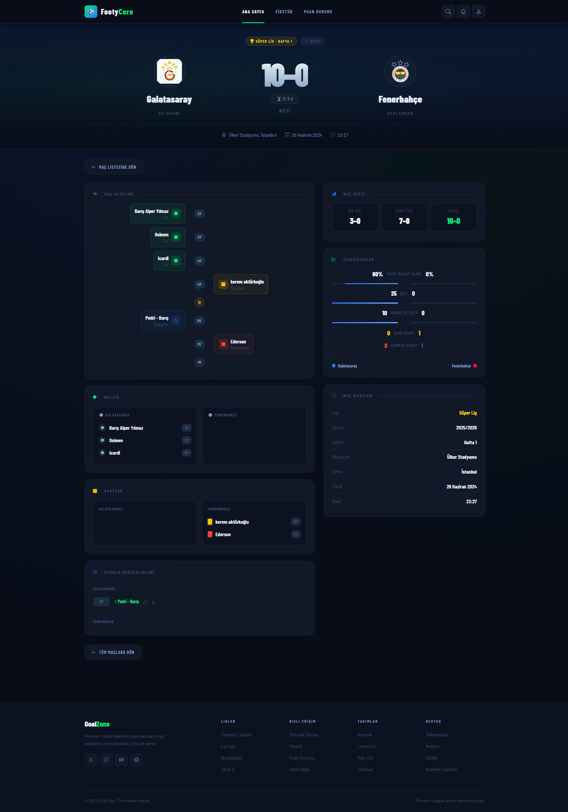
  
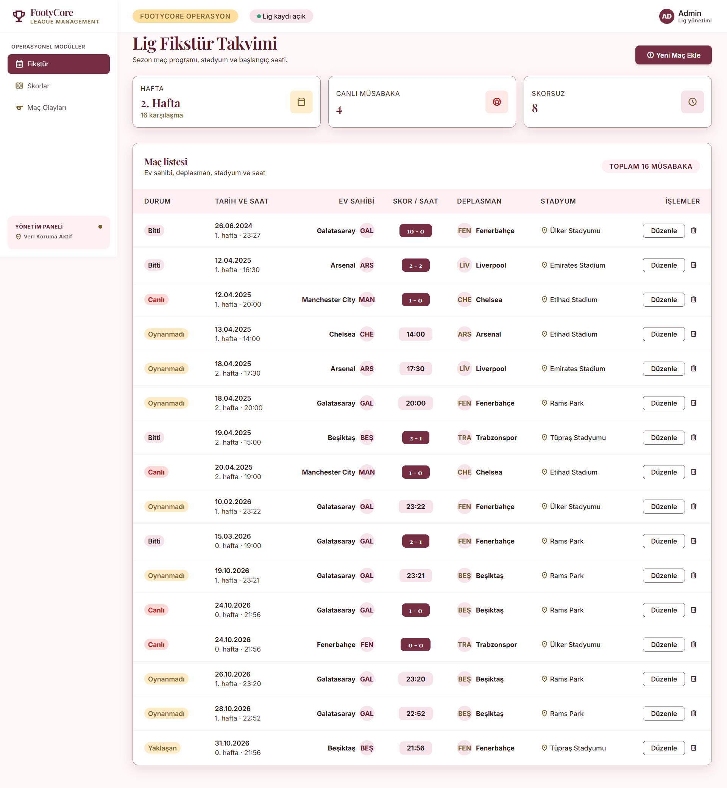
  
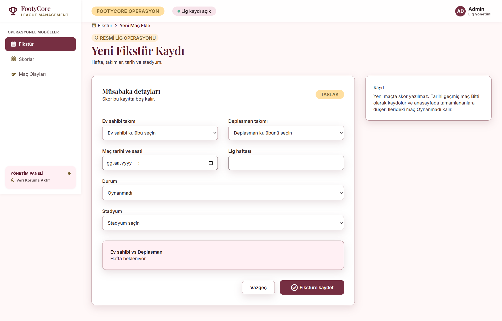
  
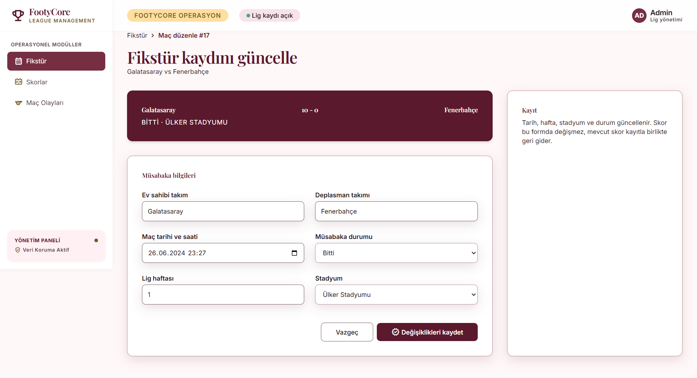
  
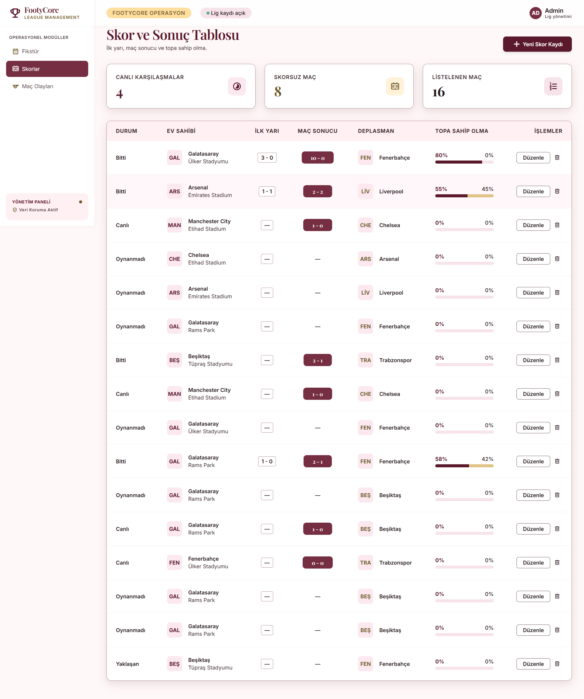
  
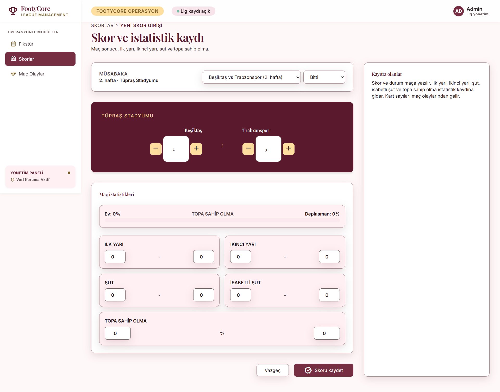
  
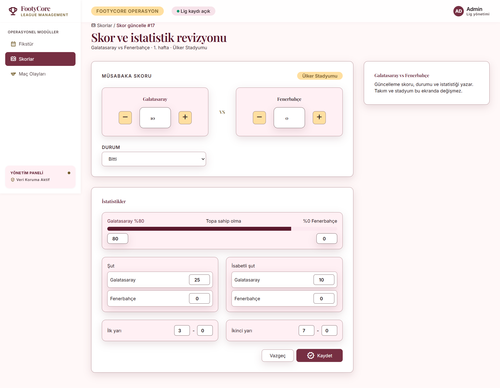
  
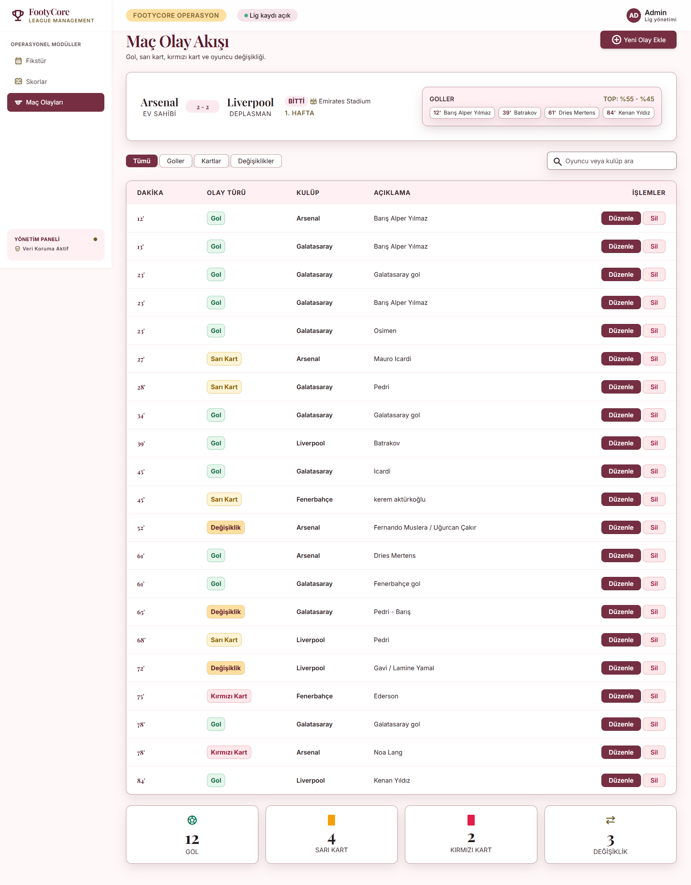
  
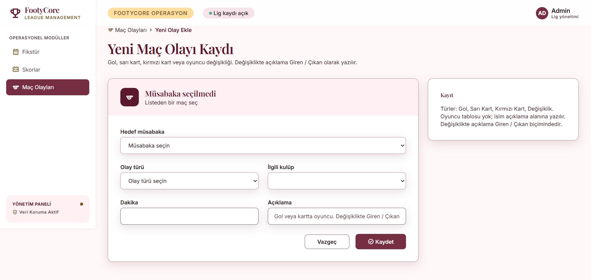
  

  <strong>FootyCore</strong> 
  Football Data · Fixtures · Results · Standings ⚽

